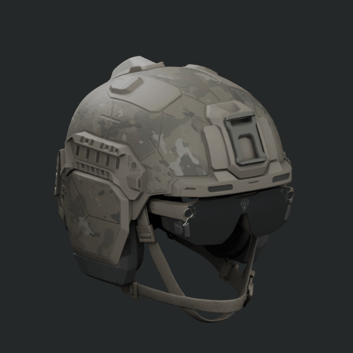
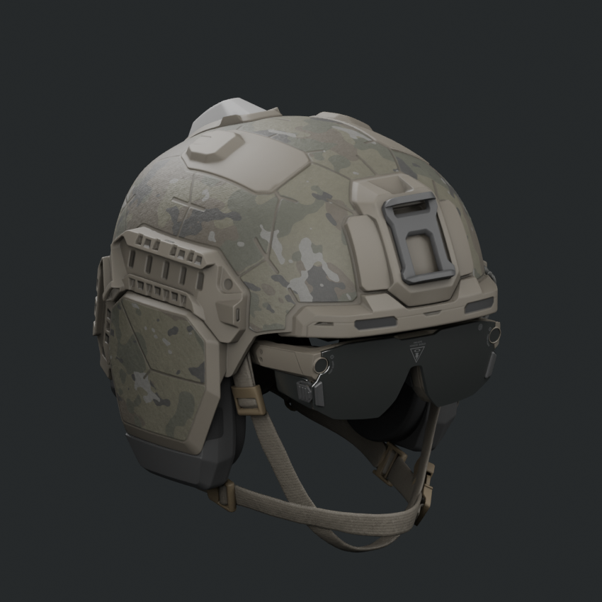
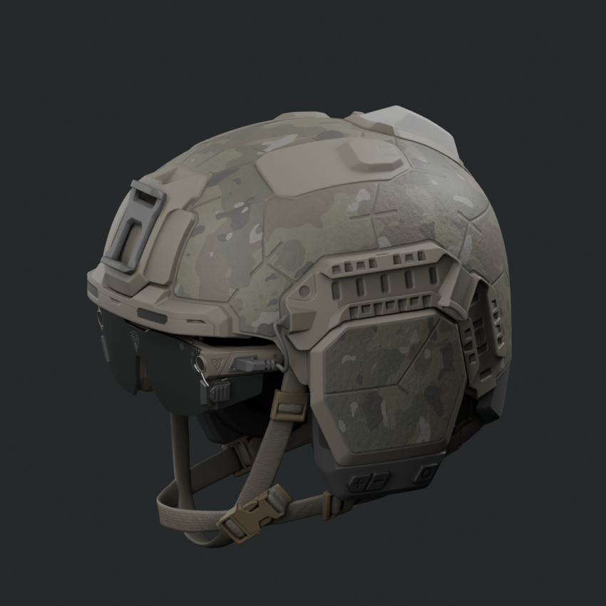
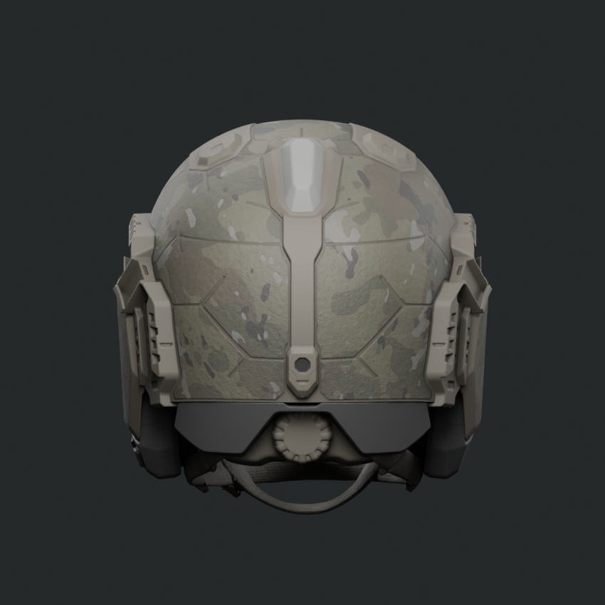
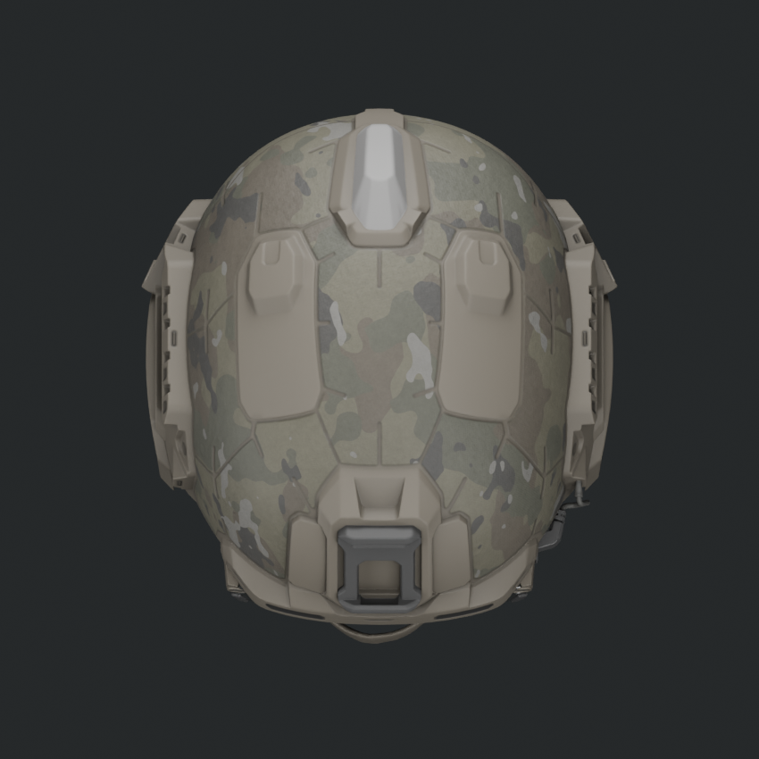

# Anduril EagleEye Helmet — Blender 3D Reference

An unofficial, editable Blender 3D asset converted from the helmet meshes
delivered by [Anduril's EagleEye website](https://www.anduril.com/eagleeye).
The file contains the helmet, eyewear, visor, and straps as nine mesh objects,
with UVs, packed textures, and an Asset Browser thumbnail.

[Download the Blender asset](assets/eagleeye-helmet.blend)

> **Source and rights:** This is an unofficial conversion of Anduril website
> assets, with no affiliation or endorsement implied. Redistribution and
> commercial-use rights have not been established; see [Attribution and
> rights](ATTRIBUTION.md) and [Anduril's terms of use](https://www.anduril.com/terms-of-use).

## Open the 3D model in Blender

1. Open the [asset file](assets/eagleeye-helmet.blend) on GitHub and choose
   **Download raw file**, then open it in Blender.
2. To add the helmet to an existing scene, choose **File → Append**, select
   the `.blend` file, then select **Collection → EagleEye - Website Helmet
   Reference**.
3. To use it from the Asset Browser, add the folder containing the `.blend` to
   Blender's Asset Libraries in **Edit → Preferences → File Paths**.

The file was checked with Blender 5.2.2 LTS. The helmet's textures are packed
inside the `.blend`; the preview camera and lights are in their own collection.
Compatibility with earlier Blender versions has not been checked.

## Rendered views

These images are Blender renders of the recovered website model, not
photographs of a physical helmet.

| Front three-quarter | Opposite side |
| --- | --- |
|  |  |
| Rear | Top |
|  |  |

[View the underside render](media/eagleeye-helmet-blender-underside.png)

## Fidelity and limits

The helmet geometry, UV coordinates, and retained source normal data match the
decoded website meshes. The camouflage uses the site's mask and fourfold UV
repeat; the visor, materials, and lighting are Blender approximations of the
website's custom shader. The model is a visual reference, not a manufacturer
CAD file, and its physical dimensions have not been established.

The wearer and separate battery seen on the website are not included in this
standalone helmet asset. The source URLs and hashes are recorded in the
[provenance manifest](provenance/source-manifest.json), the bounded checks in
[verification.json](provenance/verification.json), and the local file hashes
in [SHA256SUMS.txt](SHA256SUMS.txt).
